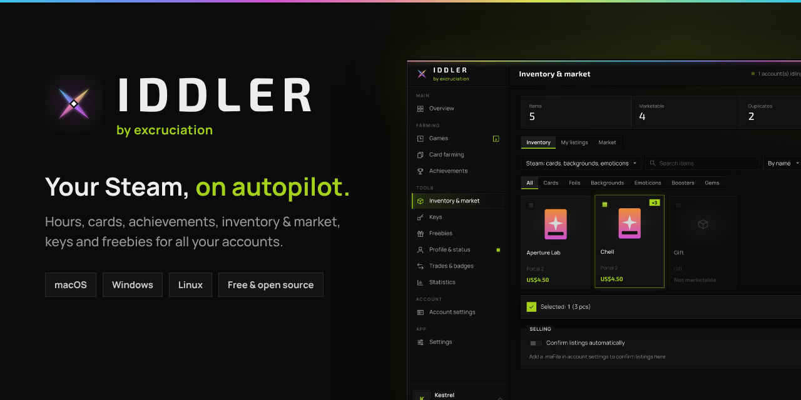
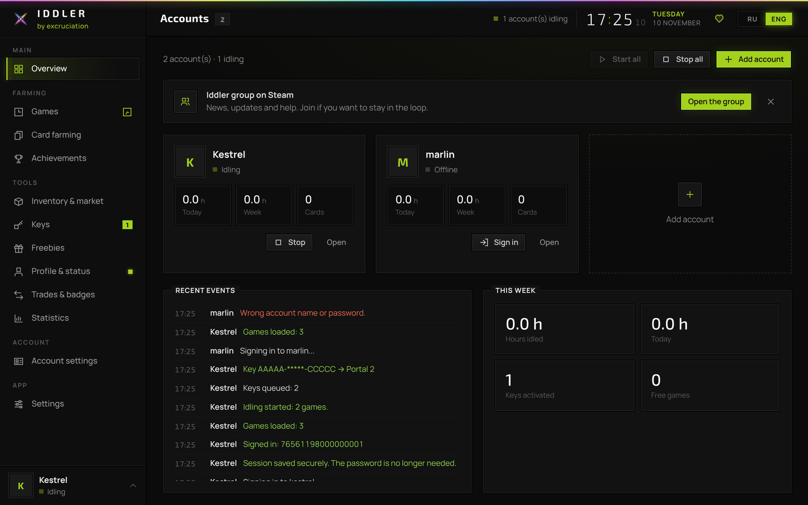
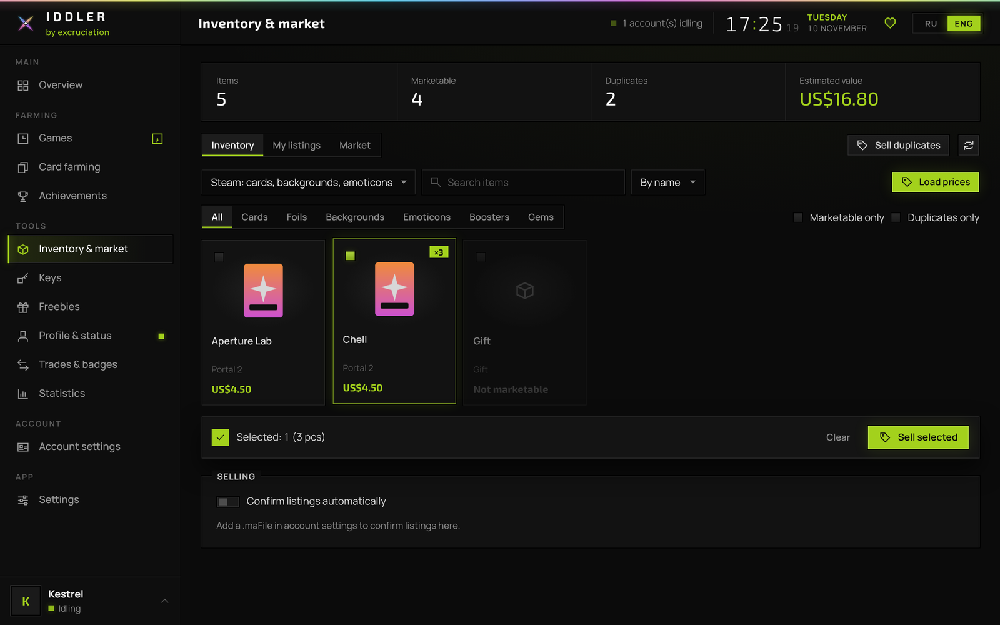
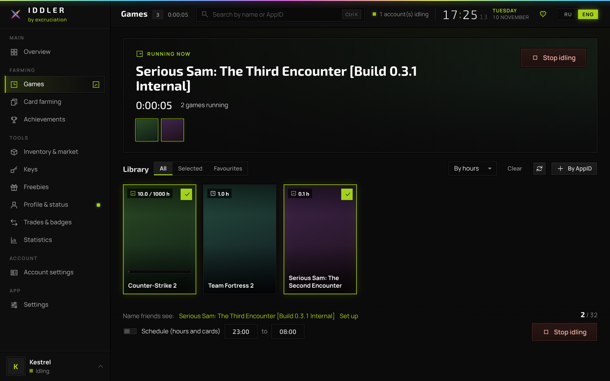
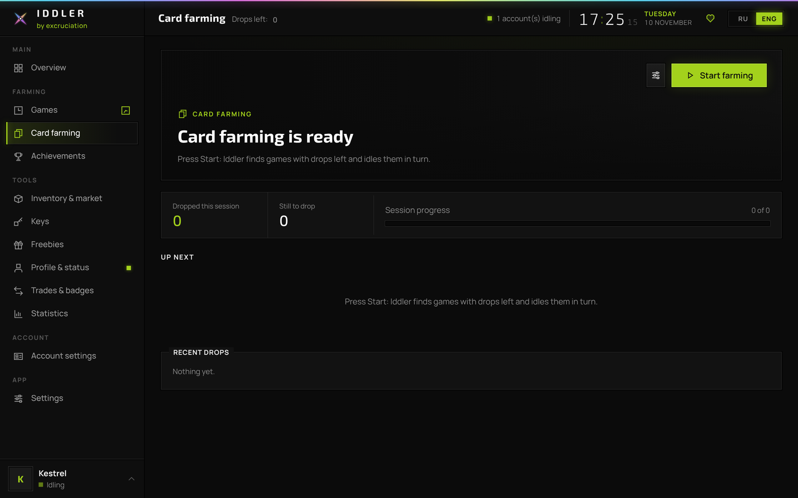
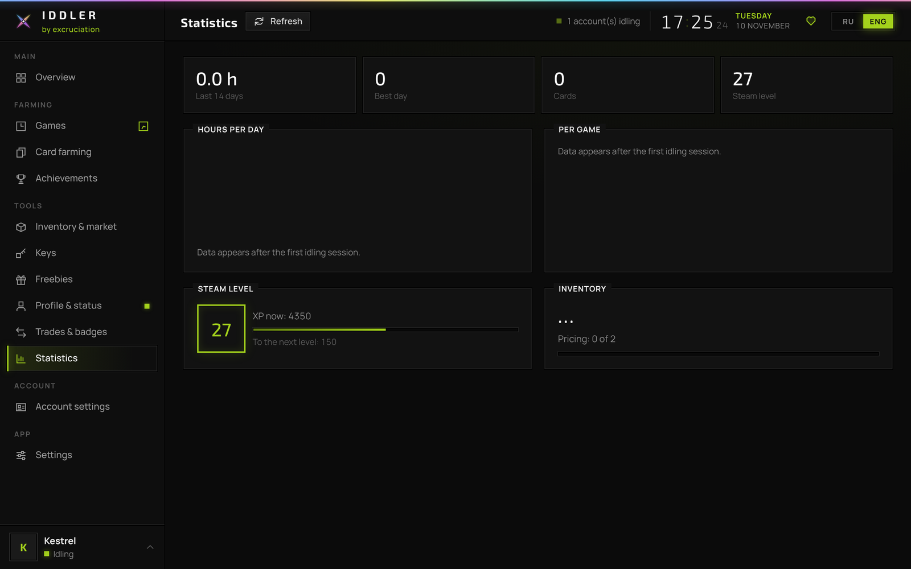

<p align="center">
  <a href="https://excruciation69.github.io/iddler/"></a>
</p>

<p align="center">
  <a href="../../releases/latest"></a>
  <a href="#installation"></a>
  <a href="#installation"></a>
  <a href="#installation"></a>
  <a href="LICENSE"></a>
</p>

<p align="center">
  <a href="https://excruciation69.github.io/iddler/">Website</a>
  &nbsp;&nbsp;·&nbsp;&nbsp;
  <a href="CHANGELOG.md">Changelog</a>
  &nbsp;&nbsp;·&nbsp;&nbsp;
  <a href="README.ru.md">Русский</a>
</p>

<br>

Iddler takes care of the routine side of Steam. It idles hours, collects card drops, opens achievements,
sells what you don't need and activates keys, for every account you own, quietly in the background.

It is a single native application for macOS, Windows and Linux. There is nothing else to install:
no Steam client, no runtime, no configuration files.

<br>

<p align="center">
  
</p>

<br>

## Capabilities

<table>
  <tr>
    <td width="33%" valign="top">
      <h4>Hours</h4>
      Up to 32 games per account at once, with an hours goal for each game and an optional schedule.
    </td>
    <td width="33%" valign="top">
      <h4>Card drops</h4>
      Every game with drops left is idled to the last card. Skip lists, priority lists and the two hour rule are built in.
    </td>
    <td width="33%" valign="top">
      <h4>Achievements</h4>
      Opened all at once, or one by one at a natural pace and only within the hours you allow.
    </td>
  </tr>
  <tr>
    <td valign="top">
      <h4>Inventory and market</h4>
      Live prices, selling of single items, selections or every duplicate, listing management and market search.
    </td>
    <td valign="top">
      <h4>Confirmations</h4>
      Listings are confirmed inside the app, by hand or automatically, using your <code>.maFile</code>.
    </td>
    <td valign="top">
      <h4>Keys</h4>
      Paste any text. Keys are found, queued within Steam's limits and kept in a full history.
    </td>
  </tr>
  <tr>
    <td valign="top">
      <h4>Accounts</h4>
      Sign in with a password or a QR code from the Steam app. Switch between accounts in one click.
    </td>
    <td valign="top">
      <h4>Profile</h4>
      Custom game titles for friends, day and night names, online status and an auto reply.
    </td>
    <td valign="top">
      <h4>Everywhere</h4>
      Runs from the menu bar or tray, sends updates to your own Telegram bot and opens on your phone over Wi‑Fi.
    </td>
  </tr>
</table>

<br>

<p align="center">
  
  
</p>
<p align="center">
  
  
</p>

<br>

## Installation

Builds for every platform are attached to the [latest release](../../releases/latest).

**macOS 11 or later**, Apple Silicon and Intel. Move Iddler.app to Applications and run once in Terminal:

```sh
xattr -cr /Applications/Iddler.app && codesign --force --deep -s - /Applications/Iddler.app
```

**Windows 10 and 11**, x64 and ARM. Run the `.exe`. If SmartScreen asks, choose *More info*, then *Run anyway*.

**Linux**, x64 and arm64. Extract the archive and start `./iddler`. The interface opens in your browser.

<br>

## Privacy

Your password is sent to Steam and nowhere else; it is never stored. The session is kept encrypted by the
macOS Keychain or Windows DPAPI. The interface is available only on your own computer, protected by a key
that changes with every launch.

<br>

## Questions

<details>
<summary>Is it safe for my account?</summary>
<br>
Idling hours and collecting cards are long established practices, and Iddler connects to Steam exactly as the
official client does. Changing achievements is against the Steam Subscriber Agreement; avoid it in games with VAC or ranked play.
</details>

<details>
<summary>Does Steam have to be running?</summary>
<br>
No. Iddler connects on its own. If you start playing on another device, idling pauses and resumes afterwards.
</details>

<details>
<summary>Can I sell items without my phone?</summary>
<br>
Yes, once a <code>.maFile</code> is added in the account settings. Without it, listings are confirmed in the Steam mobile app.
</details>

<details>
<summary>Where are my settings stored?</summary>
<br>
<code>~/Library/Application Support/Iddler</code> on macOS, <code>%APPDATA%\Iddler</code> on Windows and <code>~/.config/iddler</code> on Linux.
</details>

<br>

## Building

Go 1.24 and Python 3 are required.

```sh
git clone https://github.com/excruciation69/iddler && cd iddler
go test ./...
./scripts/build.sh
```

Every tag of the form `v*` is built and published automatically.

<br>

## Support

Iddler is free. If it is useful to you, you are welcome to support its development.

<table>
  <tr>
    <td></td>
    <td>
      USDT, TRC20 network<br>
      <code>TUWXd4f3g3pSjxEgM7upWtCBdn774dJgPu</code>
      <br><br>
      Binance Pay ID<br>
      <code>446743475</code>
    </td>
  </tr>
</table>

<a href="https://steamcommunity.com/groups/iddle2003">Steam group</a>
&nbsp;·&nbsp;
<a href="https://steamcommunity.com/profiles/76561199171650128/">Steam profile</a>
&nbsp;·&nbsp;
<a href="https://t.me/excruciation69">Telegram</a>

<br>

---

<sub>Released under the <a href="LICENSE">MIT License</a>. © excruciation. Iddler is not affiliated with Valve Corporation. Steam is a trademark of Valve Corporation.</sub>
