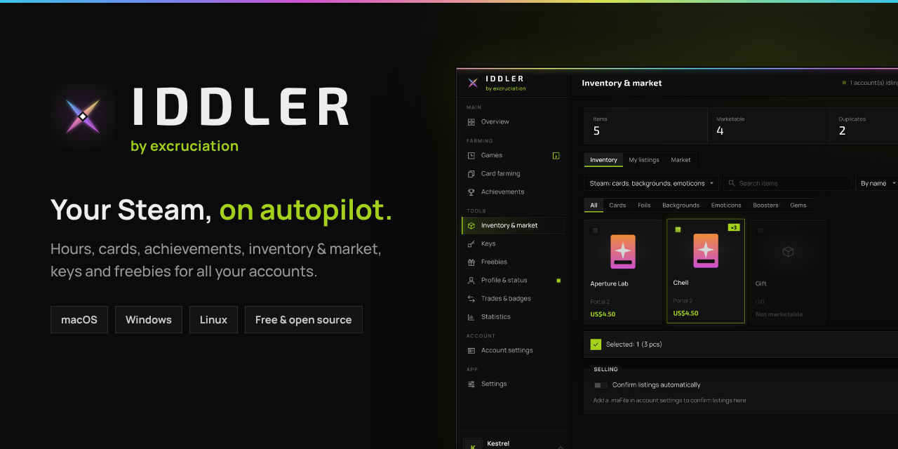
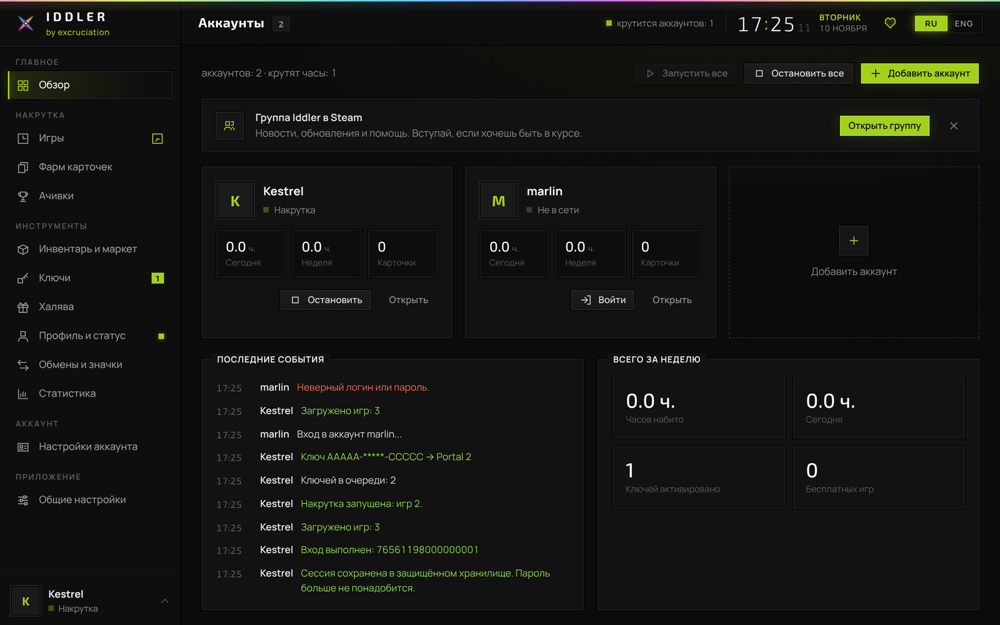
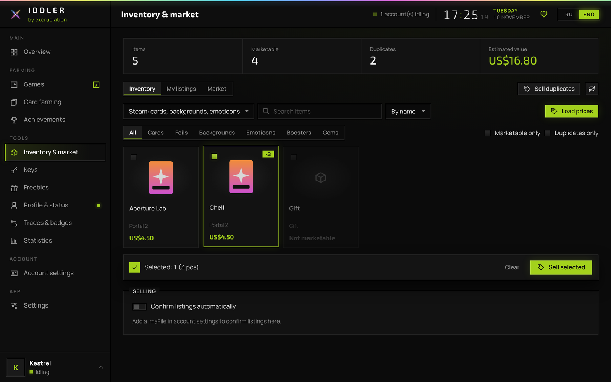
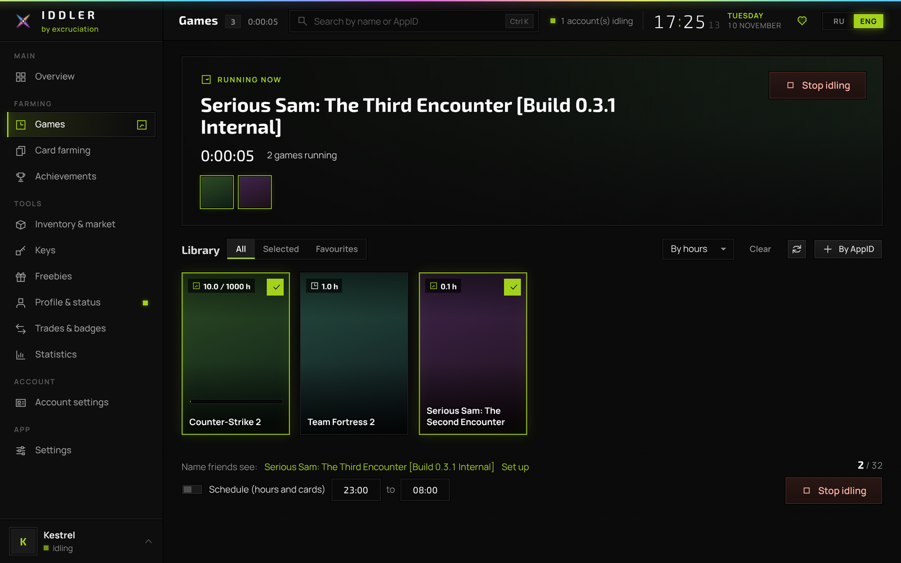
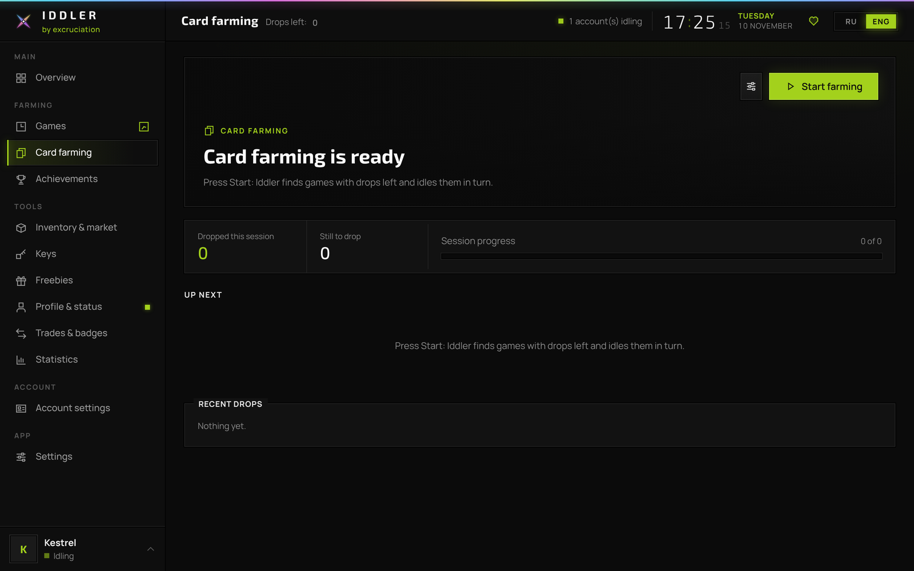
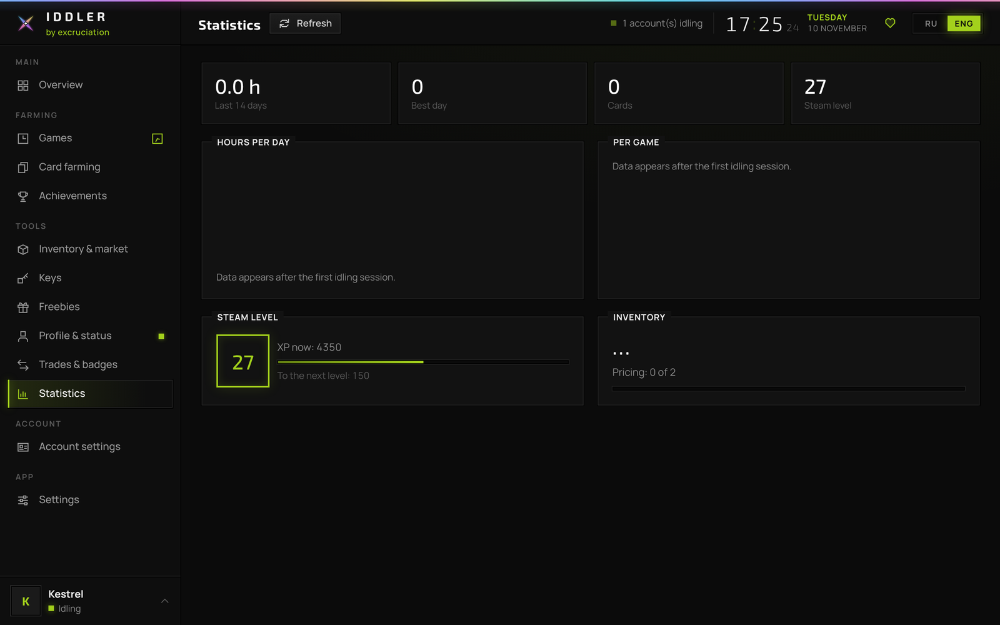

<p align="center">
  <a href="https://excruciation69.github.io/iddler/"></a>
</p>

<p align="center">
  <a href="../../releases/latest"></a>
  <a href="#установка"></a>
  <a href="#установка"></a>
  <a href="#установка"></a>
  <a href="LICENSE"></a>
</p>

<p align="center">
  <a href="https://excruciation69.github.io/iddler/">Сайт</a>
  &nbsp;&nbsp;·&nbsp;&nbsp;
  <a href="CHANGELOG.md">Изменения</a>
  &nbsp;&nbsp;·&nbsp;&nbsp;
  <a href="README.md">English</a>
</p>

<br>

Iddler берёт на себя рутину Steam. Он набивает часы, собирает карточки, открывает достижения,
продаёт ненужное и активирует ключи на всех твоих аккаунтах, тихо и в фоне.

Это одно приложение для macOS, Windows и Linux. Больше ничего ставить не нужно:
ни клиента Steam, ни дополнительных библиотек, ни файлов настроек.

<br>

<p align="center">
  
</p>

<br>

## Возможности

<table>
  <tr>
    <td width="33%" valign="top">
      <h4>Часы</h4>
      До 32 игр на аккаунт одновременно, цель по часам для каждой игры и расписание по желанию.
    </td>
    <td width="33%" valign="top">
      <h4>Карточки</h4>
      Каждая игра с карточками крутится до последней. Списки исключений, приоритетов и правило двух часов уже внутри.
    </td>
    <td width="33%" valign="top">
      <h4>Достижения</h4>
      Открываются все сразу или по одному, в естественном темпе и только в разрешённые часы.
    </td>
  </tr>
  <tr>
    <td valign="top">
      <h4>Инвентарь и маркет</h4>
      Цены в реальном времени, продажа одного предмета, выбранных или всех дубликатов, управление лотами и поиск по маркету.
    </td>
    <td valign="top">
      <h4>Подтверждения</h4>
      Лоты подтверждаются прямо в приложении, вручную или автоматически, через <code>.maFile</code>.
    </td>
    <td valign="top">
      <h4>Ключи</h4>
      Вставь любой текст. Ключи найдутся, встанут в очередь с учётом лимитов Steam и сохранятся в истории.
    </td>
  </tr>
  <tr>
    <td valign="top">
      <h4>Аккаунты</h4>
      Вход по паролю или по QR-коду из приложения Steam. Переключение между аккаунтами в один клик.
    </td>
    <td valign="top">
      <h4>Профиль</h4>
      Свои названия игр для друзей, дневной и ночной ник, статус в сети и автоответ.
    </td>
    <td valign="top">
      <h4>Всегда рядом</h4>
      Работает из строки меню или трея, присылает новости в твой Telegram-бот и открывается на телефоне по Wi‑Fi.
    </td>
  </tr>
</table>

<br>

<p align="center">
  
  
</p>
<p align="center">
  
  
</p>

<br>

## Установка

Сборки для всех систем прикреплены к [последнему релизу](../../releases/latest).

**macOS 11 и новее**, Apple Silicon и Intel. Перенеси Iddler.app в «Программы» и один раз выполни в Терминале:

```sh
xattr -cr /Applications/Iddler.app && codesign --force --deep -s - /Applications/Iddler.app
```

**Windows 10 и 11**, x64 и ARM. Запусти `.exe`. Если SmartScreen спросит, нажми «Подробнее», затем «Выполнить в любом случае».

**Linux**, x64 и arm64. Распакуй архив и запусти `./iddler`. Интерфейс откроется в браузере.

<br>

## Приватность

Пароль уходит только в Steam и нигде не сохраняется. Сессия хранится в зашифрованном виде в связке ключей
macOS или в DPAPI Windows. Интерфейс доступен только на твоём компьютере и защищён ключом, который меняется
при каждом запуске.

<br>

## Вопросы

<details>
<summary>Это безопасно для аккаунта?</summary>
<br>
Накрутка часов и сбор карточек давно стали привычной практикой, а Iddler подключается к Steam так же, как
официальный клиент. Изменение достижений нарушает Соглашение подписчика Steam; не делай этого в играх с VAC и рейтингом.
</details>

<details>
<summary>Нужно ли запускать Steam?</summary>
<br>
Нет. Iddler подключается сам. Если начать играть на другом устройстве, накрутка встанет на паузу и продолжится после.
</details>

<details>
<summary>Можно ли продавать без телефона?</summary>
<br>
Да, если добавить <code>.maFile</code> в настройках аккаунта. Без него лоты подтверждаются в мобильном приложении Steam.
</details>

<details>
<summary>Где хранятся настройки?</summary>
<br>
<code>~/Library/Application Support/Iddler</code> на macOS, <code>%APPDATA%\Iddler</code> на Windows и <code>~/.config/iddler</code> на Linux.
</details>

<br>

## Сборка

Нужны Go 1.24 и Python 3.

```sh
git clone https://github.com/excruciation69/iddler && cd iddler
go test ./...
./scripts/build.sh
```

Каждый тег вида `v*` собирается и публикуется автоматически.

<br>

## Поддержка

Iddler бесплатный. Если он тебе полезен, можно поддержать разработку.

<table>
  <tr>
    <td></td>
    <td>
      USDT, сеть TRC20<br>
      <code>TUWXd4f3g3pSjxEgM7upWtCBdn774dJgPu</code>
      <br><br>
      Binance Pay ID<br>
      <code>446743475</code>
    </td>
  </tr>
</table>

<a href="https://steamcommunity.com/groups/iddle2003">Группа в Steam</a>
&nbsp;·&nbsp;
<a href="https://steamcommunity.com/profiles/76561199171650128/">Профиль Steam</a>
&nbsp;·&nbsp;
<a href="https://t.me/excruciation69">Telegram</a>

<br>

---

<sub>Распространяется по <a href="LICENSE">лицензии MIT</a>. © excruciation. Iddler не связан с Valve Corporation. Steam является товарным знаком Valve Corporation.</sub>
